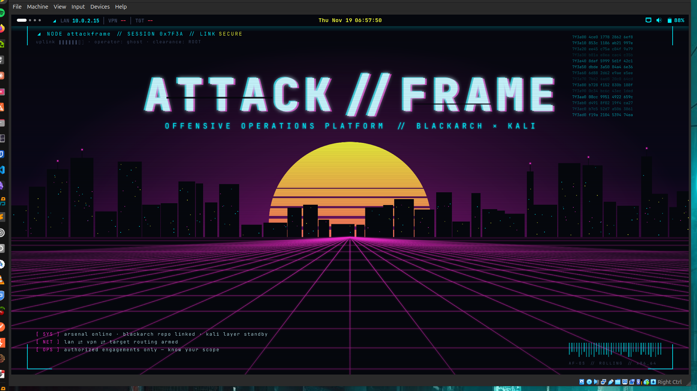
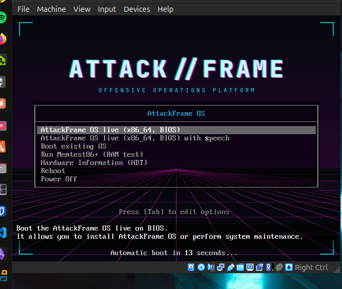
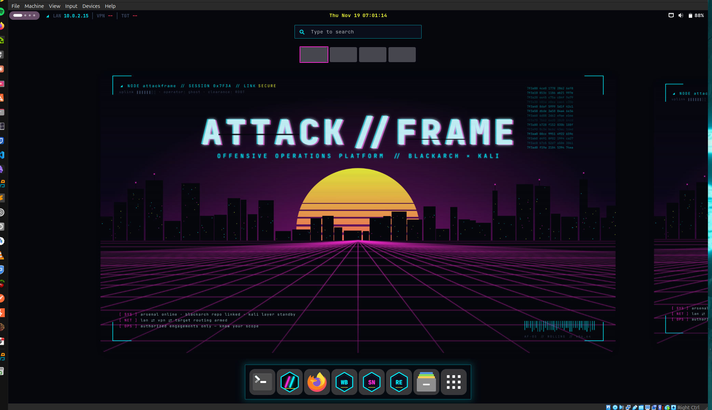
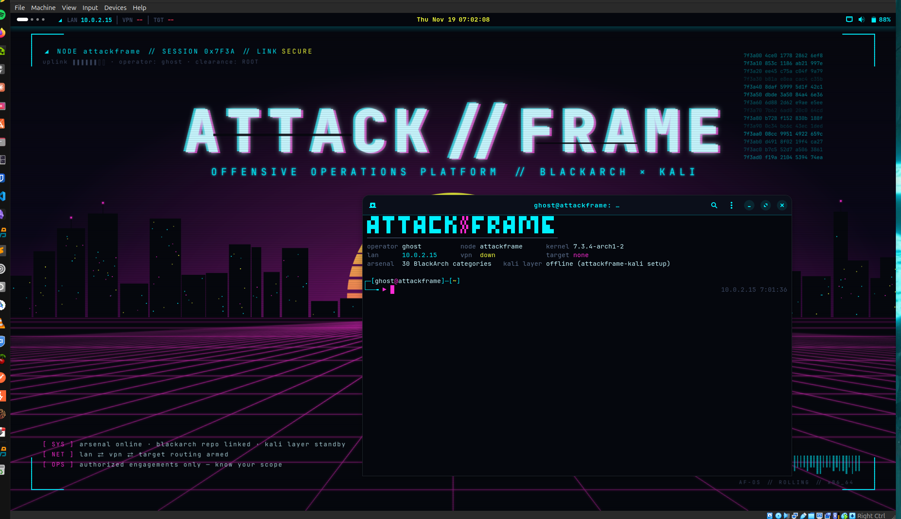
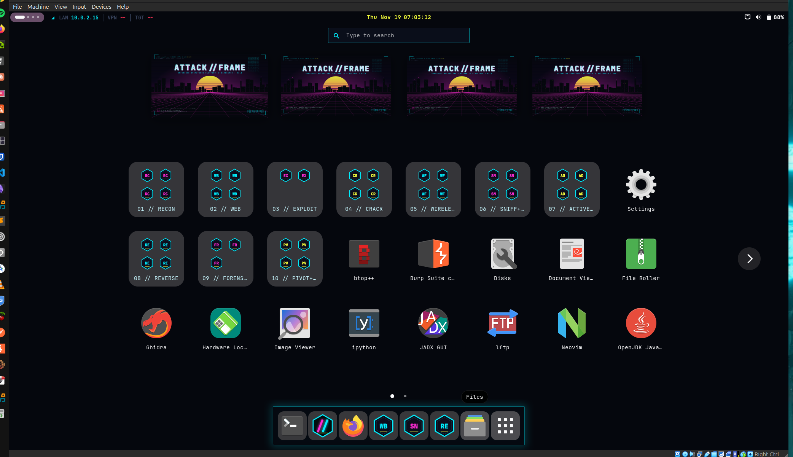
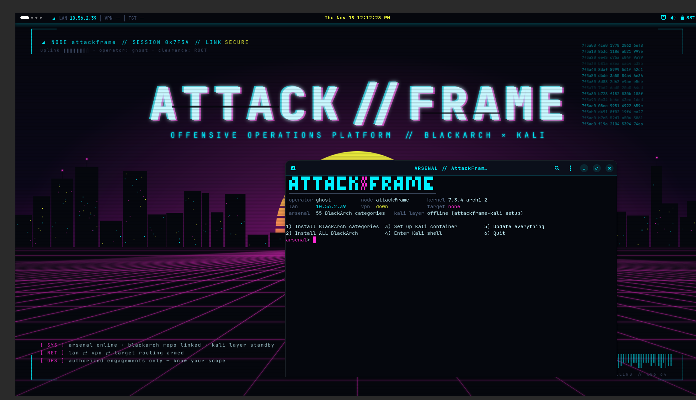

# AttackFrame OS

A cyberpunk penetration-testing distro: **Arch Linux + the full BlackArch repository** natively, **the full Kali repository** in an integrated container layer, and a neon-HUD **GNOME** desktop inspired by the operator (all artwork is original).

```
 ▄▀█ ▀█▀ ▀█▀ ▄▀█ █▀▀ █▄▀ ▞▞ █▀▀ █▀█ ▄▀█ █▀▄▀█ █▀▀
 █▀█  █   █  █▀█ █▄▄ █ █ ▞▞ █▀  █▀▄ █▀█ █ ▀ █ ██▄
```

## Why two layers?

Kali is Debian (`.deb`/apt) and BlackArch is Arch (`.pkg.tar.zst`/pacman). Their packages can't share one root filesystem without breaking each other's libraries. AttackFrame:

| Layer | Source | How | Size |
| --- | --- | --- | --- |
| Native | Arch + **BlackArch** (~2,800 tools, 50+ categories) | pacman, `attackframe-arsenal` | curated core on the ISO, rest on demand |
| Kali | **kali-rolling** (every Kali metapackage) | rootful distrobox, host network + raw sockets, shared `$HOME` | `kali-linux-default` → `everything` |

Inside the OS, `kali <tool>` runs any Kali tool as if it were native.

## Build

Needs Docker or Podman, ~40 GB free disk, a few GB RAM. Works on any Linux host.

```bash
./build.sh
```

| Variable | Default | Meaning |
| --- | --- | --- |
| `TOOLSET` | `core` | `core` = curated ~90 tools · `categories` = core + whole BlackArch groups in `BA_GROUPS` · `full` = all BlackArch (huge, expect conflicts) |
| `BA_GROUPS` | recon webapp exploitation cracker wireless | groups used by `TOOLSET=categories` |
| `STRAP_SHA1` | — | enforce BlackArch `strap.sh` checksum (published on blackarch.org/downloads) |

The ISO lands in `out/`. Package names that vanish from the repos are skipped with a warning.

Test it in a VM:

```bash
qemu-system-x86_64 -enable-kvm -m 8G -smp 4 -cdrom out/attackframe-*.iso -vga virtio -display gtk,gl=on
```

## Using it

The live session auto-logs in as `ghost` (passwordless sudo, live only).

| Command | What it does |
| --- | --- |
| `attackframe-arsenal menu` | interactive installer (also the **AttackFrame Arsenal** app) |
| `attackframe-arsenal install webapp wireless` | add whole BlackArch categories |
| `attackframe-arsenal full` | everything in BlackArch |
| `attackframe-kali setup ` [default|large|everything|top10|tools] | build the Kali layer |
| `kali <tool>` / `kali` | run a Kali tool / open a Kali shell |
| `attackframe-kali export <tool>` | put a Kali binary/app on the host PATH / app grid |
| `target 10.10.11.5` | set the engagement target (shown in prompt + top-bar HUD, `$TGT`) |
| `lhost` | your VPN IP if a tunnel is up, else LAN IP (`$LHOST`) |
| `scan`, `fullscan` | nmap presets against `$TGT` |

### Install to disk

```bash
sudo archinstall 
# Install is the same for ArchLinux - Keep User as ghost - shell scripts for pentesting are move to this account! Partion
# should be ext4
sudo cp -r /etc/pacman.d/* /mnt/etc/pacman.d/ # Profile: minimal; don't chroot at the end; leave /mnt mounted
sudo attackframe-postinstall /mnt
# When done you will reboot into new system.
```

## The look

-   **Palette** — void `#05070d`, cyan `#00f0ff`, magenta `#ff2bd6`, yellow `#f5ff3b`, ice `#c8f7ff`
-   **Shell theme** — built at boot from the stock GNOME dark theme + `overrides.css` (survives GNOME upgrades via a pacman hook)
-   **HUD extension** — top bar shows `◢ LAN │ VPN │ TGT`, click to copy any of them
-   **App grid** — tools grouped into folders `01 // RECON` … `10 // PIVOT+C2` with hex icons
-   **Terminal** — neon gnome-terminal profile, JetBrains Mono Nerd Font, operator prompt + banner
-   **GTK** — libadwaita/adw-gtk3 recoloured to match; Papirus-Dark icons; neon-framed overview dash

## Layout

```
build.sh                       host entry point (runs the build in an Arch container)
scripts/build-in-container.sh  BlackArch bootstrap, profile assembly, mkarchiso
scripts/gen-assets.py          regenerates assets/*.svg
scripts/gen-wallpapers{,2,3}.py  regenerate the 50-wallpaper pack (assets/wallpapers/*.svg; vol 1 = 10, vol 2 = 20, vol 3 = 20)
scripts/render-wallpapers.sh   renders the pack to 4K PNGs in assets/wallpapers/png/
packages/                      desktop + core tool package lists
assets/                        wallpaper, boot splash, icons (SVG sources)
profile/airootfs/              files overlaid on archiso's releng profile
```

Use only on systems you own or are authorised to test.

## Console

The Console gives you access to Kali and BlackArch on the same instance. BlackArch has some intresting tools, that Kali does not have.  
  
  












